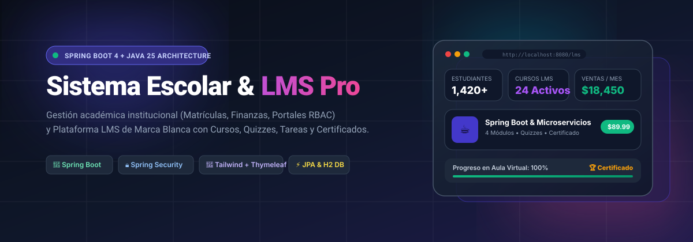
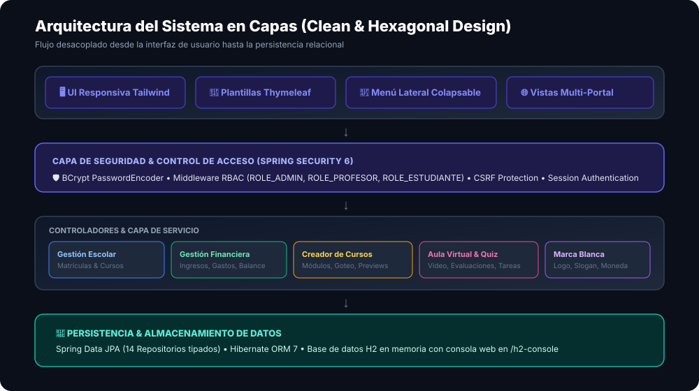
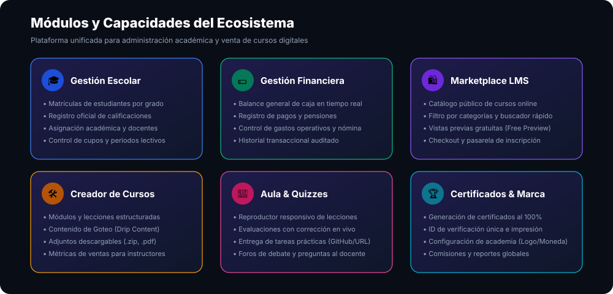

<div align="center">

# 🎓 Sistema Integral de Gestión Escolar & Plataforma LMS Multi-Tenant

<p align="center">
  
</p>

[](https://spring.io/projects/spring-boot)
[](https://openjdk.org/)
[](https://spring.io/projects/spring-security)
[](https://tailwindcss.com/)
[](https://www.thymeleaf.org/)
[](https://www.h2database.com/)

<p align="center">
  <strong>Solución integral que combina la gestión académica y financiera escolar tradicional con una moderna academia online LMS de cursos de marca blanca, creada con estándares de arquitectura limpia en Spring Boot.</strong>
</p>

[Demostración](#-credenciales-de-prueba-y-demostración) •
[Módulos](#-módulos-y-capacidades-del-sistema) •
[Arquitectura](#-arquitectura-del-software) •
[Instalación](#-instalación-y-ejecución-rápida) •
[Endpoints](#-rutas-y-endpoints-del-sistema)

</div>

---

## 📌 Tabla de Contenidos

- [Descripción General](#-descripción-general)
- [Arquitectura del Software](#-arquitectura-del-software)
- [Módulos y Capacidades del Sistema](#-módulos-y-capacidades-del-sistema)
  - [1. Plataforma LMS y Creador de Cursos](#1-plataforma-lms-y-creador-de-cursos)
  - [2. Gestión Escolar y Académica](#2-gestión-escolar-y-académica)
  - [3. Gestión Financiera y Tesorería](#3-gestión-financiera-y-tesorería)
  - [4. Seguridad y Middleware RBAC](#4-seguridad-y-middleware-rbac)
- [Credenciales de Prueba y Demostración](#-credenciales-de-prueba-y-demostración)
- [Instalación y Ejecución Rápida](#-instalación-y-ejecución-rápida)
- [Rutas y Endpoints del Sistema](#-rutas-y-endpoints-del-sistema)
- [Estructura del Proyecto](#-estructura-del-proyecto)
- [Licencia y Autor](#-licencia-y-autor)

---

## 📖 Descripción General

Este proyecto resuelve dos necesidades fundamentales en una única plataforma unificada:

1. **Gestión Escolar Completa**: Matrículas de estudiantes por grado escolar, asignación docente, registro y cálculo de calificaciones académicas, y balance financiero (ingresos de matrículas vs gastos operativos y nómina).
2. **Plataforma LMS de Aprendizaje y Monetización**: Creación y venta de cursos online bajo tu propia marca con reproductor de lecciones en video/conferencias, cuestionarios evaluados al instante, retos prácticos con entrega de soluciones, contenido programado por goteo (*Drip Content*), foros de debate y emisión automática de certificados oficiales al alcanzar el 100% de progreso.

---

## 🏗️ Arquitectura del Software

El sistema sigue el patrón de **Arquitectura en Capas Limpia (Clean Layered Architecture)** asegurando alta cohesión, bajo acoplamiento y facilidad de testing:

<p align="center">
  
</p>

- **Capa de Presentación**: Plantillas HTML5 con Thymeleaf, maquetación moderna mediante Tailwind CSS y menú lateral responsivo con soporte móvil.
- **Capa de Seguridad**: Spring Security con autenticación basada en sesiones seguras, protección CSRF y control de acceso basado en roles (`ROLE_ADMIN`, `ROLE_PROFESOR`, `ROLE_ESTUDIANTE`).
- **Capa de Controladores & Servicios**: Controladores REST y MVC desacoplados que orquestan los casos de uso de matrícula, finanzas, cursos y evaluaciones.
- **Capa de Persistencia**: 14 repositorios Spring Data JPA con consultas optimizadas (`JOIN FETCH`) y motor Hibernate 7 sobre base de datos H2 en memoria.

---

## 🚀 Módulos y Capacidades del Sistema

<p align="center">
  
</p>

### 1. Plataforma LMS y Creador de Cursos

- **🎥 Lecciones y Conferencias**: Soporte para múltiples formatos: Video clases embebidas responsivas, Masterclasses en vivo y Artículos teóricos estructurados.
- **❓ Cuestionarios y Evaluaciones (Quizzes)**: Preguntas de opción múltiple (A, B, C) con corrección en tiempo real, retroalimentación inmediata y puntaje mínimo para aprobar la lección.
- **📋 Tareas Prácticas**: Asignación de proyectos aplicados, entrega mediante enlaces (GitHub, Google Drive, Figma) o notas detalladas, con retroalimentación y calificación del instructor.
- **📎 Archivos Adjuntos del Curso**: Soporte para descargas complementarias en cada lección (`.zip`, `.pdf`, `.ipynb`).
- **👁️ Vista Previa del Curso (Free Preview)**: Muestras gratuitas para visitantes sin compra previa, permitiendo ver clases introductorias para acelerar la conversión de nuevos estudiantes.
- **⏳ Contenido de Goteo (Drip Content)**: Desbloqueo progresivo programado según los días transcurridos desde la fecha de inscripción.
- **📈 Seguimiento del Progreso & Certificado**: Barra de progreso porcentual dinámica (0% a 100%), checklist de lecciones y generación automática del **Certificado Oficial de Finalización** con ID de validación e impresión en PDF.
- **⭐ Reseñas y Calificaciones**: Desglose gráfico de calificaciones de 1 a 5 estrellas con promedio general acumulado.
- **💬 Foros de Debate (Q&A)**: Hilos de preguntas de estudiantes con respuestas destacadas del docente.
- **🎨 Marca Blanca (White-Label)**: Personalización institucional del nombre de la academia, eslogan, logotipo, porcentaje de comisión y moneda.

### 2. Gestión Escolar y Académica

- **Matrículas Escolares**: Inscripción de estudiantes organizados por grados escolares y periodos académicos.
- **Portal de Profesores**: Registro ágil de notas por estudiante, visualización de asignaturas a cargo y listado de alumnos.
- **Portal de Estudiantes**: Consulta de calificaciones, promedio general acumulado e historial de materias cursadas.

### 3. Gestión Financiera y Tesorería

- **Balance en Tiempo Real**: Cálculo automático de ingresos totales, gastos acumulados y balance neto disponible.
- **Ingresos**: Cobro automatizado de matrículas y pensiones estudiantiles.
- **Egresos**: Registro de pagos a proveedores, mantenimiento, nómina docente y servicios.

### 4. Seguridad y Middleware RBAC

- Encriptación robusta de contraseñas con `BCryptPasswordEncoder`.
- Redirección inteligente post-login según el rol del usuario autenticado:
  - `ROLE_ADMIN` ➔ Redirección al panel administrativo `/admin`.
  - `ROLE_PROFESOR` ➔ Redirección al panel docente y creador de cursos `/profesor`.
  - `ROLE_ESTUDIANTE` ➔ Redirección a su aula y calificaciones `/estudiante`.

---

## 🔑 Credenciales de Prueba y Demostración

El sistema se inicia con datos precargados listos para probar todos los perfiles de usuario desde [http://localhost:8080/login](http://localhost:8080/login):

| Rol | Correo Electrónico | Contraseña | Permisos y Capacidades |
| :--- | :--- | :--- | :--- |
| **👑 Administrador** | `admin@colegio.edu` | `admin123` | Control total escolar, finanzas, tesorería, configuración de marca blanca y academia. |
| **👨‍🏫 Profesor / Instructor** | `roberto.gomez@colegio.edu` | `prof123` | Creador de cursos, gestión de lecciones/quizzes, respuesta a debates y notas académicas. |
| **🎓 Estudiante** | `santiago.gomez@estudiante.edu` | `est123` | Aula virtual, resolución de cuestionarios, entregas prácticas y certificado al 100%. |

---

## 💻 Instalación y Ejecución Rápida

### Requisitos Previos

- **Java JDK 21 o superior** (probado y verificado en OpenJDK 25).
- Conexión a internet para la descarga inicial de dependencias Maven.

### Pasos para Ejecutar

```bash
# 1. Clonar el repositorio
git clone https://github.com/hamstersoftwarecol/sistema-gestion-escolar-lms.git
cd sistema-gestion-escolar-lms

# 2. Compilar y ejecutar con el Maven Wrapper incluido
./mvnw spring-boot:run
```

Una vez que la consola muestre `Started DemoApplication`, abre tu navegador en:
👉 **[http://localhost:8080](http://localhost:8080)** o **[http://localhost:8080/lms](http://localhost:8080/lms)**

Para acceder a la consola de base de datos H2:
👉 **[http://localhost:8080/h2-console](http://localhost:8080/h2-console)** (JDBC URL: `jdbc:h2:mem:escolardb` / Usuario: `sa` / Clave: vacía)

---

## 🌐 Rutas y Endpoints del Sistema

### Rutas Públicas (LMS & Catálogo)
- `GET /` ➔ Redirección o página principal.
- `GET /login` ➔ Formulario de autenticación con diseño moderno.
- `GET /lms` ➔ Catálogo y marketplace de cursos con filtros y búsqueda.
- `GET /lms/curso/{id}` ➔ Temario detallado, desglose de calificaciones y foro Q&A.
- `GET /lms/curso/{id}/preview/{leccionId}` ➔ Vista previa gratuita de lecciones de muestra.

### Aula Virtual & Experiencia del Alumno (Requiere Autenticación)
- `GET /lms/aprender/{cursoId}` ➔ Aula interactiva con reproductor y temario lateral.
- `POST /lms/aprender/{cursoId}/completar` ➔ Marcar lección completada y recalcular progreso.
- `POST /lms/aprender/{cursoId}/quiz` ➔ Enviar evaluación con calificación inmediata.
- `POST /lms/aprender/{cursoId}/tarea` ➔ Entrega de reto práctico del estudiante.
- `GET /lms/curso/{cursoId}/certificado` ➔ Certificado oficial descargable e imprimible (al 100%).
- `POST /lms/curso/{id}/comprar` ➔ Simulación de compra e inscripción en curso.

### Portal de Docentes e Instructores
- `GET /lms/instructor` ➔ Panel de cursos creados, estadísticas de ventas y gestión de módulos.
- `POST /lms/instructor/crear-curso` ➔ Crear nuevo producto educativo.
- `POST /lms/instructor/modulo/crear` ➔ Añadir módulo o sección temaria.
- `POST /lms/instructor/leccion/crear` ➔ Crear lección (Video, Conferencia, Quiz, Tarea, Drip).
- `POST /lms/curso/{id}/debate/{debateId}/responder` ➔ Responder inquietud de un alumno.

### Gestión Administrativa & Marca Blanca
- `GET /admin` ➔ Dashboard administrativo con estadísticas de la institución.
- `GET /matriculas` ➔ Gestión de matrículas por estudiante y grado escolar.
- `GET /finanzas` ➔ Módulo de tesorería (ingresos, gastos, balance).
- `GET /lms/configuracion` ➔ Editor de marca blanca (Logo, Eslogan, Moneda, Comisión).

---

## 📁 Estructura del Proyecto

```text
javaspring/
├── pom.xml                                   # Configuración de dependencias Maven
├── mvnw / mvnw.cmd                           # Maven Wrapper portable
├── assets/                                   # Recursos gráficos y diagramas SVG
│   ├── banner.svg                            # Banner principal del proyecto
│   ├── architecture.svg                      # Diagrama de arquitectura en capas
│   └── features.svg                          # Showcase de módulos y características
├── src/
│   ├── main/
│   │   ├── java/com/example/demo/
│   │   │   ├── config/                       # Inicializador de datos (DataLoader)
│   │   │   ├── controller/                   # Controladores escolares y financieros
│   │   │   ├── lms/                          # Sub-sistema LMS
│   │   │   │   ├── controller/               # LmsController (Marketplace, Aula, Instructor)
│   │   │   │   ├── model/                    # Modelos (Curso, Modulo, Leccion, Quiz, Tarea, etc.)
│   │   │   │   ├── repository/               # Repositorios JPA del LMS
│   │   │   │   └── service/                  # LmsService (Lógica de negocio, Drip, Progreso)
│   │   │   ├── model/                        # Entidades escolares (Usuario, Matricula, Transaccion)
│   │   │   ├── repository/                   # Repositorios JPA escolares
│   │   │   ├── security/                     # SecurityConfig, CustomUserDetailsService, SuccessHandler
│   │   │   └── service/                      # Servicios escolares y contables
│   │   └── resources/
│   │       ├── application.properties        # Configuración de JPA, H2 y Thymeleaf
│   │       └── templates/                    # Vistas HTML Thymeleaf con Tailwind
│   │           ├── admin/                    # Vistas administrativas
│   │           ├── fragments/                # Layout común y Sidebar responsivo
│   │           ├── lms/                      # Vistas del LMS (catálogo, aula, certificado, etc.)
│   │           └── login.html                # Formulario de inicio de sesión
│   └── test/                                 # Pruebas unitarias y de integración
└── README.md                                 # Documentación técnica en español
```

---

## 📄 Licencia

Este proyecto se encuentra bajo la Licencia [MIT](LICENSE). Puedes utilizarlo libremente para fines educativos, comerciales o institucionales.

---

<div align="center">
  <sub>Desarrollado con ❤️ para centros educativos, academias online y creadores de contenido.</sub>
</div>
